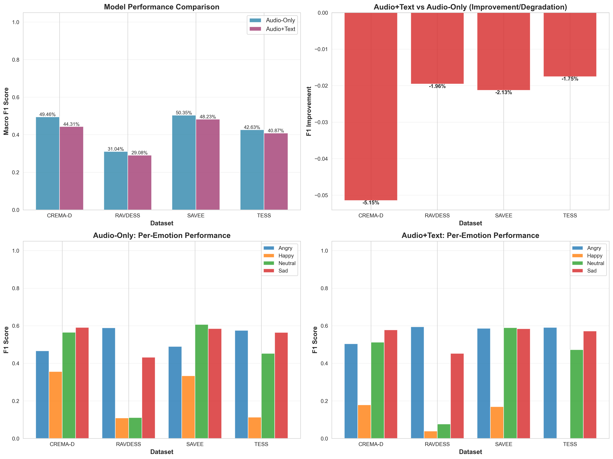

# Better Emotion Recognition AI

Speech emotion recognition with a fine-tuned **WavLM-Large** encoder, an optional **DistilRoBERTa** text branch fed by Whisper transcripts, and an auxiliary valence/arousal/dominance (VAD) regression head. The model predicts four emotions: **Angry, Happy, Neutral, Sad**.

It is trained on podcast speech (MSP-Podcast segments from NaturalVoices EVC) with speaker-independent folds. It is then evaluated zero-shot on four acted-speech corpora: CREMA-D, RAVDESS, SAVEE and TESS.

## Results

Cross-dataset macro-F1, zero-shot. No external corpus was seen in training.

| Dataset  | Audio-only | Audio+text* |
|----------|-----------:|------------:|
| CREMA-D  | **49.46%** | 44.31% |
| RAVDESS  | **31.04%** | 29.08% |
| SAVEE    | **50.35%** | 48.23% |
| TESS     | **42.63%** | 40.87% |
| **Average** | **43.37%** | 40.62% |

\* No transcripts exist for the external corpora, so the audio+text model ran with its text embedding zeroed. These numbers show how it degrades when text is missing. They are not a measure of real multimodal performance.



Observations:
- The audio-only model generalizes better across corpora on every dataset.
- **Happy** is the weakest class almost everywhere. It is close to 0 F1 on TESS for the audio+text model.
- RAVDESS is the hardest corpus. Neutral and Happy are frequently confused there.

## Architecture

```
audio (16 kHz, ≤8 s) ─► WavLM-Large ─► attention pooling ─► 1024-d ─┐
                                                                   ├─► concat ─► MLP (512) ─► 4 emotion logits
text (Whisper) ─► DistilRoBERTa ─► masked mean pool ─► 768-d ──────┘         └─► MLP (256) ─► VAD (3)
```

- **Loss:** class-weighted cross-entropy with label smoothing (0.05), plus `vad_lambda × MSE` on VAD targets.
- **Optimization:** AdamW with cosine schedule and 10% warmup, mixed precision on CUDA, and early stopping on validation macro-F1.
- **Text dropout:** during training, 10% of samples get their text embedding zeroed. This lets the model tolerate a missing transcript.
- **Audio-only variant:** `use_text=False` drops the text branch completely.

## Repository layout

```
src/
  config.py              Paths, model names, emotion labels
  download_evc.py        Download the Emotion_Balanced training set from Hugging Face
  build_manifest.py      Match audio files to metadata → data/manifest.csv
  make_speaker_folds.py  5 speaker-independent folds (train / val / calibration) → data/splits.json
  transcribe_fast.py     Whisper transcripts with faster-whisper → data/transcripts.csv
  transcribe_dataset.py  Same, with the transformers ASR pipeline
  dataset.py             PyTorch dataset (cropping, padding, optional in-memory audio cache)
  model.py               EmotionModel (WavLM + optional DistilRoBERTa, attention pooling, VAD head)
  train.py               Audio+text training
  train_optimized.py     Same with extra GPU-throughput tuning (used by run_training.sh)
  train_audio_only.py    Audio-only training
  calibrate.py           Temperature scaling + confidence threshold for an abstain policy
  evaluate.py            Held-out fold metrics: accuracy, macro-F1, ECE, NLL, VAD RMSE/Pearson
  report.py              Aggregate results across folds
  compare_models.py      Quick audio-only vs audio+text comparison on manifest samples
  evaluate_both_models.py  Cross-dataset evaluation on CREMA-D / RAVDESS / SAVEE / TESS
  visualize_results.py   Plots for the cross-dataset results → results/
  predict.py             Single-file inference (Whisper + emotion model)
  gui.py                 Tkinter app: record from mic or pick a random file and predict
  gpu_monitor.py, gpu_optimize.py  GPU diagnostics / live monitoring
run_ensemble.sh          Train all 5 folds
run_training.sh          Remote-VM launcher (background training + GPU monitoring)
check_training.sh        Check status of a run started by run_training.sh
deploy_and_run.sh        rsync code to a JarvisLabs VM and start training
test_system.py           Forward-pass smoke test
results/                 Cross-dataset result figures
```

## Setup

```bash
python -m venv .venv && source .venv/bin/activate
pip install -r requirements.txt
python test_system.py   # smoke test: downloads wavlm-base + distilroberta, runs one forward pass
```

The GUI also requires Tk and PortAudio for `sounddevice`. On macOS, run `brew install portaudio`.

## Data preparation

Run all commands from the repository root.

```bash
# 1. Training data (NaturalVoices EVC "Emotion_Balanced", ~MSP-Podcast segments)
python src/download_evc.py --token <HF_TOKEN>   # → Emotion_Balanced/

# 2. Manifest + speaker-independent folds
python src/build_manifest.py                     # → data/manifest.csv
python src/make_speaker_folds.py                 # → data/splits.json

# 3. Transcripts for the text branch (optional for audio-only)
python src/transcribe_fast.py                    # → data/transcripts.csv
```

Folds are split by speaker with `GroupKFold`. Each fold's held-out speakers are then split 50/50 into an early-stopping set and a calibration set. No speaker appears in more than one split.

## Training

```bash
# Audio + text, one fold
python src/train.py --fold 0 --batch_size 16 --epochs 10 --lr 1e-5

# Audio only
python src/train_audio_only.py --fold 0

# All five folds
bash run_ensemble.sh
```

Checkpoints are written to `checkpoints/fold_<k>_seed_<s>/best_model.pt` (audio+text) or `checkpoints/fold_<k>_audio_only/best_model_audio_only.pt`. WavLM-Large needs a large GPU. Training was done on an A100.

To train on a remote VM:

```bash
JARVISLABS_PORT=<port> bash deploy_and_run.sh <fold> <batch_size> <seed>   # from your machine
bash check_training.sh <fold>                                              # on the VM
```

## Calibration and evaluation

```bash
python src/calibrate.py --fold 0 --target_error 0.10   # temperature + abstain threshold
python src/evaluate.py  --fold 0                       # metrics on held-out speakers
python src/report.py                                   # summary across folds
```

### Cross-dataset evaluation

Put the external corpora in a single folder with this layout:

```
external_datasets/
  Crema/*.wav
  Ravdess/audio_speech_actors_01-24/Actor_*/*.wav
  Savee/*.wav
  Tess/<SPEAKER>_<emotion>/*.wav
```

Then run:

```bash
python src/evaluate_both_models.py --datasets_root external_datasets   # → comparison_results.json
python src/visualize_results.py                                       # → results/*.png
```

The script loads `final_models/best_model_audio_only.pt` and `final_models/best_model_audio_text.pt`.

## Inference

```bash
python src/predict.py path/to/clip.wav --model_path final_models/best_model_audio_text.pt
python src/gui.py
```

`predict.py` transcribes the clip with Whisper (tiny), runs the audio+text model, and prints the emotion, its confidence and the VAD scores. The GUI loads `checkpoints/fold_0_seed_42/best_model_with_transcription.pt` by default. To use a different checkpoint, edit `model_path` in `src/gui.py`.

## Model weights

The trained checkpoints are not in this repository. Each one is 1.2–1.6 GB, which exceeds GitHub's file size limit. Place them in `final_models/` to run evaluation and inference.

## Limitations

- Only four emotion classes. Labels from other corpora (Fear, Disgust, Surprise, Calm, …) are excluded during evaluation.
- Cross-corpus macro-F1 is around 43%. Two likely causes are the domain shift from spontaneous podcast speech to acted studio speech, and Happy being under-recognized.
- The audio+text model depends on ASR quality and has not been evaluated with real transcripts on the external corpora.
- There is no untouched in-domain test set yet. `evaluate.py` reports on each fold's held-out speakers, but those speakers are also used for early stopping and calibration.
- `test_system.py` only checks output shapes. It does not validate model quality or the full pipeline.
